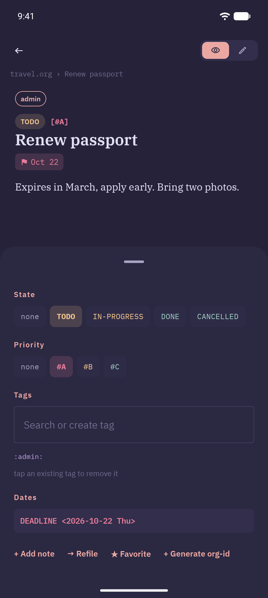

The metadata sheet is a structured, tap-driven alternative to hand-editing a heading's org syntax. Open it from the floating ☰ button at the bottom-right of [Read](/features/read-mode) or [Edit](/features/edit-mode) mode.

## Sections

- **State**: tap any configured TODO keyword (none, TODO, IN-PROGRESS, DONE, KILL, or your own custom set from Settings → Notes) to cycle the heading's state. Moving from a todo keyword (or none) to a done keyword stamps `CLOSED: [date time]` and adds a `- State "DONE" from "TODO" [date time]` entry at the top of the `:LOGBOOK:` drawer, the way Emacs does with `org-log-done`. The same applies to marking done from Outline, Search, Agenda, the widget, and reminder notifications
- **Priority**: none, `#A`, `#B`, `#C`
- **Tags**: free-text field, space-separated; suggestion chips surface tags already used elsewhere in your vault as you type
- **Dates**: a single pill summarizing SCHEDULED, DEADLINE, and any bare active `<date>` events together; tap it to open [Planning Dates](/features/planning-dates), which lands on whichever tab makes sense for what is already set

When both a SCHEDULED and a DEADLINE date are set, the pill shows them stacked on two lines (`SCHED ...` above `DUE ...`) rather than crammed onto one, so both stay legible.

## Add note

**+ Add note** opens the same timestamped-note dialog available from Outline View's swipe action; it appends an entry to the heading's `:LOGBOOK:` drawer without leaving the current screen.

## Related

- [Planning Dates](/features/planning-dates): the full SCHEDULED/DEADLINE editor behind the pill
- [Read Mode](/features/read-mode) / [Edit Mode](/features/edit-mode): where the ☰ button lives
- [Notes Behavior](/features/notes-behavior): configuring custom TODO keyword sets and default priority
